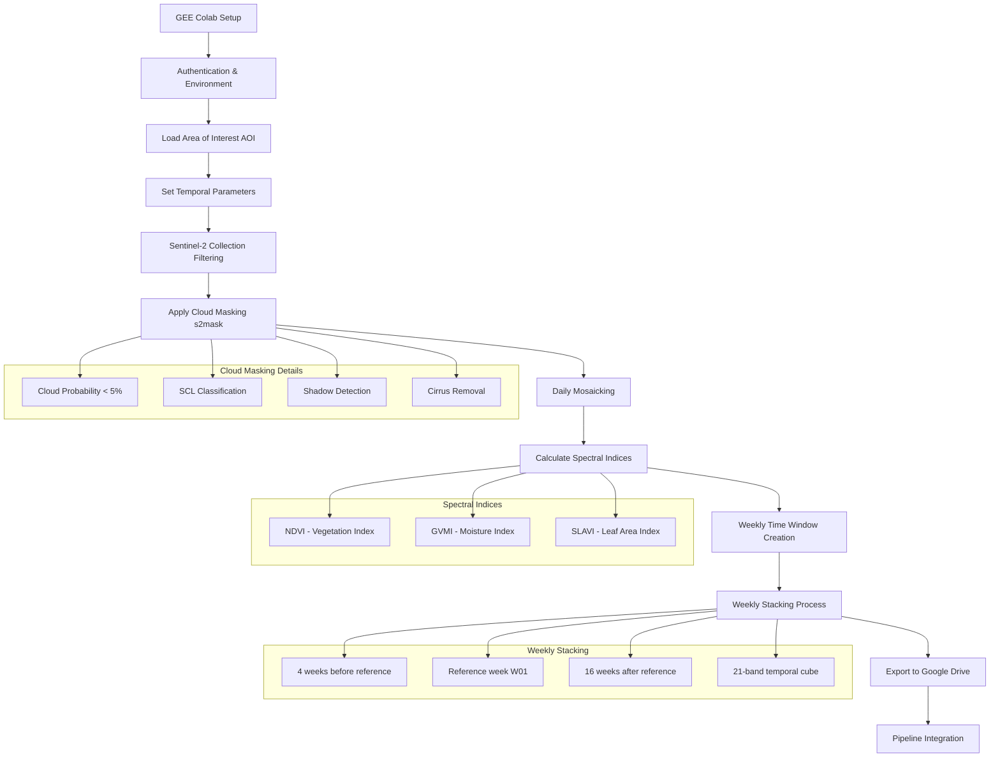
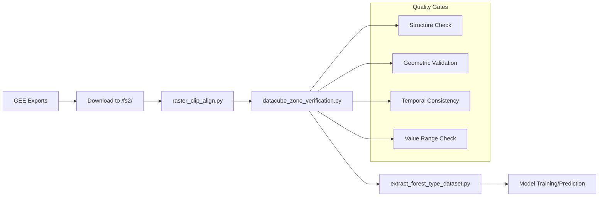

# Google Earth Engine Data Preparation v1.2.0

## Overview

This document provides comprehensive instructions for preparing Google Earth Engine (GEE) data v1.2.0 for forest type classification. The process involves extracting both Sentinel-1 radar data (VV/VH polarizations) and Sentinel-2 optical indices as weekly stacked datacubes for multiple years across different zones.

## 🗂️ GEE Data Preparation Flow Summary

### Combined Input Data Flow
```
AOI Definition → Date Range Parameters → [S1 GRD Collection + S2 SR Collection] → Quality Filtering → Daily Mosaicking
```

### Sentinel-1 Processing Flow
```
Raw S1 GRD → Orbit/Mode Filtering → VV/VH Selection → Daily Mosaicing → Weekly Median → 21-Band VV/VH Cubes
```

### Sentinel-2 Processing Flow
```
Raw S2 SR → Cloud Masking → Quality Filtering → Index Calculation → Weekly Aggregation → 21-Band Index Cubes
```

### Spectral Indices Flow (S2)
```
S2 Bands → NDVI Calculation → GVMI Calculation → SLAVI Calculation → Multi-Index Dataset
```

### Temporal Processing Flow (Both S1 & S2)
```
Daily Mosaics → Weekly Windows → 4 Weeks Before → Reference Week → 16 Weeks After → 21-Band Datacubes
```

### Combined Export Flow
```
[S1 VV/VH Cubes + S2 Index Cubes + Static DEM] → Drive Export → Local Download → Pipeline Integration
```

## Data Preparation Workflow

### Complete GEE Indices Preparation Pipeline



### Simplified Linear Workflow
```
GEE Setup → AOI Loading → S2 Filtering → Cloud Masking → Daily Mosaics → Index Calculation → Weekly Stacking → Export → Integration
```

## Pipeline Summary

### Key Processing Steps
1. **Environment Setup**: Install dependencies and authenticate GEE/Drive access
2. **Data Collection**: Filter Sentinel-2 SR collection by AOI, date range, and cloud cover
3. **Quality Control**: Apply comprehensive cloud masking using multiple criteria
4. **Temporal Processing**: Create daily mosaics and calculate spectral indices
5. **Weekly Aggregation**: Stack into 21-band temporal cubes (W4before to W16after)
6. **Export**: Batch export to Google Drive with standardized naming
7. **Integration**: Files ready for main forest classification pipeline

### Processing Outputs per Zone
- **S2 Indices**: 3 types (NDVI, GVMI, SLAVI)
- **S1 Polarizations**: 2 types (VV, VH)
- **Years**: 7 years (2019-2025, configurable)
- **Total Files**: ~35 files per zone
- **File Format**: GeoTIFF with 21 temporal bands each
- **Total Size**: ~1.75-7.0 GB depending on zone size

### Quality Assurance Features
- Cloud probability filtering (<5%)
- Multi-criteria cloud masking (SCL, shadows, cirrus)
- Daily mosaicking for overlapping tiles
- Weekly compositing with gap handling
- Standardized projection and resolution (10m)

## Environment Setup

### Required Libraries Installation
```python
# Check and install required packages in Google Colab
try:
    import geemap, ee, geetools, json, pprint, PyCRS
    import geopandas as gpd
    import contextily as ctx # for basemaps
except ModuleNotFoundError:
    if 'google.colab' in str(get_ipython()):
        print("package not found, installing w/ pip in Google Colab...")
        !uv pip install geemap
        !uv pip install geopandas
        !uv pip install descartes
        !uv pip install contextily
        !uv pip install geetools
        !uv pip install PyCRS
```

### Authentication Setup
```python
# Google Cloud Authentication
from google.colab import auth
auth.authenticate_user(project_id='kinetic-pilot-213907')

# Earth Engine Authentication
try:
    ee.Initialize()
except Exception as e:
    ee.Authenticate()
    ee.Initialize()

# Google Drive Mount (for exports)
from google.colab import drive
drive.mount('/content/drive')
```

## Core Functions

### 1. Cloud Masking Function
```python
def s2mask(image):
    """
    Cloud mask function to clear the image using Sentinel-2's SCL
    Filters out clouds, cloud shadows, and high cloud probability areas
    """
    # Cloud Probability Map mask 20m
    cloudProb = image.select('MSK_CLDPRB')
    cloud = cloudProb.lt(5)  # less than 5%

    # SCL (Scene Classification Layer)
    scl = image.select('SCL')
    shadow = scl.eq(3)          # 3 = cloud shadow
    cloud_medium = scl.eq(8)    # 8 = Clouds Medium Probability
    cloud_high = scl.eq(9)      # 9 = Clouds High Probability  
    cirrus = scl.eq(10)         # 10 = cirrus

    # Merge all masks
    all_mask = cloud.And(shadow.neq(1)).And(cloud_medium.neq(1)).And(cloud_high.neq(1)).And(cirrus.neq(1))
    return image.updateMask(all_mask)
```

### 2. Spectral Indices Calculation
```python
def addIndices(image):
    """
    Calculate multiple vegetation and biophysical indices from Sentinel-2 bands
    Returns image with added spectral index bands
    """
    # Primary vegetation indices
    ndvi = image.normalizedDifference(['B8', 'B4']).rename('ndvi')  # NDVI
    gvmi = image.expression(
        '((NIR + 0.1) - (SWIR+0.02)) / ((NIR + 0.1) +(SWIR + 0.02))',
        {'NIR': image.select('B8'), 'SWIR': image.select('B12')}
    ).rename('gvmi')  # Global Vegetation Moisture Index
    
    slavi = image.expression(
        'NIR / (RED + SWIR)',
        {'NIR': image.select('B8'), 'RED': image.select('B4'), 'SWIR': image.select('B12')}
    ).rename('slavi')  # Specific Leaf Area Vegetation Index

    # Add additional indices as needed...
    return image.addBands([ndvi, gvmi, slavi])
```

### 3. Daily Mosaicking
```python
def daily_mosaics(image_collection):
    """
    Create daily mosaics from Sentinel-2 collection to handle overlapping tiles
    """
    def extract_date(image):
        return ee.Feature(None, {
            'date': ee.Date(image.get('system:time_start')).format('YYYY-MM-dd'),
            'system:time_start': image.get('system:time_start')
        })

    dates = image_collection.map(extract_date)
    unique_dates = dates.distinct('date')

    def mosaic_by_date(date_feature):
        date_str = date_feature.get('date')
        date = ee.Date.parse('YYYY-MM-dd', date_str)
        
        filtered_day = image_collection.filterDate(date, date.advance(1, 'day'))
        mosaic = filtered_day.mosaic()
        
        return mosaic.set({
            'date': date_str,
            'system:time_start': date_feature.get('system:time_start')
        })

    return ee.ImageCollection(unique_dates.map(mosaic_by_date))
```

### 4. S2 Collection Filtering
```python
def get_s2_sr_cld_col(aoi, start_date, end_date, start_month, end_month, CLOUD_FILTER):
    """
    Filter and retrieve Sentinel-2 Surface Reflectance collection
    """
    s2_sr_col = (ee.ImageCollection('COPERNICUS/S2_SR_HARMONIZED')
        .filterBounds(aoi)
        .filterDate(start_date, end_date)
        .filter(ee.Filter.calendarRange(start_month, end_month, 'month'))
        .filter(ee.Filter.lt('CLOUDY_PIXEL_PERCENTAGE', CLOUD_FILTER)))
    return s2_sr_col
```

### 5. S1 Collection Filtering
```python
def get_s1_collection(aoi, start_date, end_date):
    """
    Filter and retrieve Sentinel-1 GRD collection with VV/VH polarizations
    """
    s1_col = (ee.ImageCollection('COPERNICUS/S1_GRD')
        .filterBounds(aoi)
        .filterDate(start_date, end_date)
        .filter(ee.Filter.listContains('transmitterReceiverPolarisation', 'VV'))
        .filter(ee.Filter.listContains('transmitterReceiverPolarisation', 'VH'))
        .filter(ee.Filter.eq('instrumentMode', 'IW'))
        .filter(ee.Filter.eq('orbitProperties_pass', 'ASCENDING'))
        .select(['VV', 'VH']))
    return s1_col
```

## Weekly Stacking Process

### Weekly Window Creation
```python
import pandas as pd

def build_week_windows(year: int, weeks_before: int = 4, weeks_after: int = 16):
    """
    Build weekly time windows for a given year
    Creates 21 weekly periods: 4 weeks before + 1 reference week + 16 weeks after
    """
    jan1 = pd.Timestamp(f"{year}-01-01")
    anchor_start = jan1 - pd.offsets.Week(weekday=0)  # Monday of week containing Jan 1
    total = weeks_before + weeks_after + 1
    starts = [(anchor_start + pd.Timedelta(weeks=k - weeks_before)) for k in range(total)]
    
    wins = []
    for s in starts:
        e = s + pd.Timedelta(days=7)
        iso_year, iso_week, _ = s.isocalendar()
        wins.append({
            "iso_year": int(iso_year),
            "iso_week": int(iso_week), 
            "start": s.strftime("%Y-%m-%d"),
            "end": e.strftime("%Y-%m-%d")
        })
    return wins
```

### Weekly Index Stacking (S2)
```python
def stack_weekly_index(processed_collection, index_name: str, weekly_windows, source_proj):
    """
    Stack weekly composites of a specific index into a 21-band image
    """
    stacked = None
    for win in weekly_windows:
        start, end = win["start"], win["end"]
        iso_w = win["iso_week"]
        label = f"{index_name}_W{iso_w:02d}"
        
        filtered = processed_collection.filterDate(start, end).select(index_name)
        week_count = filtered.size()
        
        # Use mean composite for weekly aggregation
        img = ee.Image(ee.Algorithms.If(
            week_count.gt(0),
            filtered.mean().rename(label),
            ee.Image(0).updateMask(ee.Image(0)).rename(label)
        ))
        
        img = ee.Image(img).setDefaultProjection(source_proj)
        stacked = img if stacked is None else stacked.addBands(img)
    
    return stacked
```

### Weekly Radar Stacking (S1)
```python
def stack_weekly_vv_or_vh(processed_collection, weekly_windows, source_proj, band_name):
    """
    Stack weekly median composites of VV or VH polarization into a 21-band image
    """
    stacked = None
    for win in weekly_windows:
        start, end = win["start"], win["end"]
        iso_w = win["iso_week"]

        filtered = processed_collection.filterDate(start, end).select([band_name])
        count = filtered.size()

        # For each week, compute median for VV or VH; if empty, create masked Float32 bands
        wk = ee.Image(ee.Algorithms.If(
            count.gt(0),
            filtered.median().rename([band_name]).toFloat(),
            ee.Image.constant(0).toFloat().updateMask(ee.Image(0)).rename([band_name])
        ))

        # Rename bands with week suffix
        wk = wk.rename([f"{band_name}_W{iso_w:02d}"])
        wk = ee.Image(wk).setDefaultProjection(source_proj)

        stacked = wk if stacked is None else stacked.addBands(wk)
    return stacked
```

## Data Processing Parameters

### Temporal Configuration
```python
# Date range covering multiple years
START_DATE = '2019-01-01'  
END_DATE = '2025-12-31'    
START_MONTH = 1  # January
END_MONTH = 4    # April (dry season focus)
CLOUD_FILTER = 60  # Maximum cloud cover percentage

# Target years and data products
years = [2019, 2020, 2021, 2022, 2023, 2024, 2025]
s2_index_names = ['ndvi', 'gvmi', 'slavi']  # Sentinel-2 indices
s1_band_names = ['VV', 'VH']               # Sentinel-1 polarizations
```

### Spatial Configuration
```python
# Area of Interest (AOI) from uploaded assets
zone = 'zone_1'  # Example zone
df = f'projects/kinetic-pilot-213907/assets/chm_2025_{zone}'
bo_object = ee.FeatureCollection(df)
AOI = ee.Geometry(ee.FeatureCollection(bo_object).geometry())
```

## Complete Processing Workflow

### Combined S1 and S2 Processing
```python
# 1. Dynamic date range based on target years
START_DATE_DYN = f"{min(years)-1}-12-01"  # Start before first year for weekly windows
END_DATE_DYN = f"{max(years)}-07-15"      # End after dry season

# 2. Get and process Sentinel-2 collection
s2_all = (get_s2_sr_cld_col(AOI, START_DATE_DYN, END_DATE_DYN, 1, 12, CLOUD_FILTER)
          .map(s2mask)
          .select('B.*'))

# 3. Get and process Sentinel-1 collection
s1_all = get_s1_collection(AOI, START_DATE_DYN, END_DATE_DYN)

# 4. Create daily mosaics for both collections
s2_daily_mosaicked = daily_mosaics(s2_all)
s1_daily_mosaicked = daily_mosaics(s1_all).map(lambda img: img.toFloat()).select(['VV','VH'])

# 5. Calculate S2 indices
s2_processed = s2_daily_mosaicked.map(addIndices).select(s2_index_names)

# 6. Get source projections
s2_source_proj = ee.Image(s2_processed.first()).select(0).projection()
s1_source_proj = ee.Image(s1_daily_mosaicked.first()).select('VV').projection()

# 7. Export weekly stacked cubes for each year
for yr in years:
    wins = build_week_windows(yr, weeks_before=4, weeks_after=16)  # 21 bands total
    
    # Export S2 indices
    for idx in s2_index_names:
        stacked = stack_weekly_index(s2_processed, idx, wins, s2_source_proj).toFloat()
        desc = f"cube_s2_{idx}_{yr}_W4before_to_W16after_21bands"
        export_image_to_drive(stacked, desc, 
                            folder=f'GEE_Exports_{zone}', 
                            region=AOI)
    
    # Export S1 polarizations
    for band in s1_band_names:
        stacked = stack_weekly_vv_or_vh(s1_daily_mosaicked, wins, s1_source_proj, band).toFloat()
        desc = f"cube_s1_{band.lower()}_{yr}_W4before_to_W16after_21bands"
        export_image_to_drive(stacked, desc, 
                            folder=f'GEE_Exports_{zone}', 
                            region=AOI)
```

## Export Configuration

### Export Function
```python
def export_image_to_drive(image, description, folder='GEE_Exports_S2', scale=10, crs='EPSG:32647', region=None):
    """Export an EE image to Google Drive."""
    if not region:
        region = image.geometry().bounds()

    task = ee.batch.Export.image.toDrive(
        image=image,
        description=description,
        folder=folder,
        scale=scale,
        region=region,
        fileFormat='GeoTIFF'
    )
    task.start()
```

### File Naming Convention
```
# Sentinel-2 Indices
cube_s2_{index_name}_{year}_W4before_to_W16after_21bands.tif

# Sentinel-1 Polarizations  
cube_s1_{polarization}_{year}_W4before_to_W16after_21bands.tif

Examples:
Sentinel-2:
- cube_s2_ndvi_2023_W4before_to_W16after_21bands.tif
- cube_s2_gvmi_2023_W4before_to_W16after_21bands.tif
- cube_s2_slavi_2023_W4before_to_W16after_21bands.tif

Sentinel-1:
- cube_s1_vv_2023_W4before_to_W16after_21bands.tif
- cube_s1_vh_2023_W4before_to_W16after_21bands.tif
```

## Output Structure

### Datacube Specifications
- **Bands**: 21 bands per file
- **Temporal Coverage**: 4 weeks before to 16 weeks after reference period
- **Spatial Resolution**: 10 meters
- **Format**: GeoTIFF (Float32)
- **Projection**: UTM (zone-specific, typically EPSG:32647 for Thailand)
- **Data Products**: 
  - S2: 3 indices (NDVI, GVMI, SLAVI)
  - S1: 2 polarizations (VV, VH)

### Band Structure
```
Band 1-4:   W4before to W1before  (weeks before reference)
Band 5:     W01 (reference week containing Jan 1)
Band 6-21:  W02 to W16after      (weeks after reference)
```

## Quality Control

### Data Validation Steps
1. **Collection Size Check**: Verify adequate image count after filtering
2. **Date Range Validation**: Confirm temporal coverage spans target period  
3. **Cloud Coverage Assessment**: Monitor cloud percentage statistics
4. **Band Completeness**: Ensure all indices calculated successfully
5. **Export Monitoring**: Track export task status in GEE

### Expected Outputs
- **Per Zone**: ~35 files total
  - S2: 21 files (3 indices × 7 years)
  - S1: 14 files (2 polarizations × 7 years)
- **File Size**: ~50-200 MB per file depending on zone area
- **Total Export Time**: 3-6 hours depending on area size and GEE load

## Integration with Main Pipeline

The exported GEE datacubes integrate with the main forest type classification pipeline as follows:

1. **Storage**: Files downloaded to `/fs2/ftype_mflf/shared_data/gdrive/GEE_Exports_{zone}/`
2. **Alignment**: Processed by `src/raster_clip_align.py` for pixel-level alignment
3. **Quality Check**: Validated by `datacube_zone_verification.py`
4. **Feature Extraction**: Used by `scripts/extract_forest_type_dataset.py` for training data creation
5. **Prediction**: Input to `src/prediction_ftype_2_2_1.py` for forest type classification

## Pipeline Integration Flowchart



## Version History

### v1.2.0 Features
- **Combined S1 & S2 Processing**: Integrated Sentinel-1 radar and Sentinel-2 optical data
- **Weekly Stacking**: Replaces monthly max composites with 21-band weekly temporal cubes
- **Extended Temporal Window**: 4 weeks before to 16 weeks after reference period
- **Improved Cloud Masking**: Enhanced SCL-based cloud filtering for S2
- **Multiple Data Products**: 
  - S2: NDVI, GVMI, SLAVI indices
  - S1: VV, VH polarizations with median compositing
- **Zone-based Processing**: Supports multiple project zones
- **Automated Export**: Batch export system for multiple years and data products

### Improvements from Previous Versions
- More temporally detailed (weekly vs monthly)
- Better cloud masking using multiple criteria
- Consistent 21-band structure across all indices
- Automated batch processing capabilities
- Enhanced quality control and validation

## Troubleshooting

### Common Issues
1. **Export Quota Exceeded**: Reduce concurrent exports or use smaller regions
2. **Missing Data**: Check cloud filter settings and date ranges
3. **Authentication Errors**: Re-authenticate GEE and Google Drive
4. **Memory Errors**: Reduce processing area or use more efficient aggregation methods

### Best Practices
- Monitor export tasks in GEE Code Editor
- Start with small test areas before full processing
- Backup export configurations in version control
- Document any parameter changes for reproducibility

## Related Documentation
- [Final Pipeline Overview](./final_pipline/DATA_PIPELINE_OVERVIEW.md)
- [GEE Data Source Documentation](./final_pipline/GEE_DATA_SOURCE.md)
- [Datacube Verification Guide](./final_pipline/DATACUBE_VERIFICATION.md)