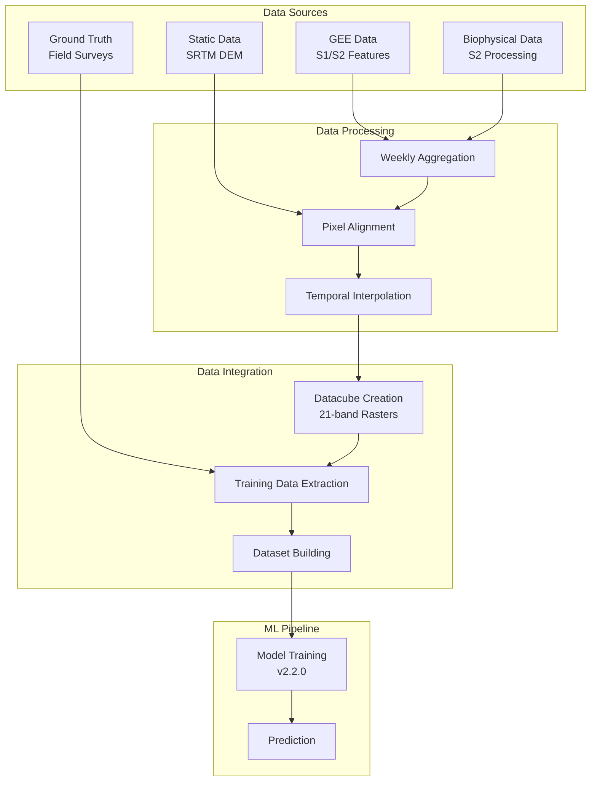

# Forest Type Classification Data Pipeline Overview

## Executive Summary

The Forest Type Classification data pipeline processes multi-temporal satellite data from two primary sources to create machine learning datasets for forest classification. This document provides a high-level overview of the complete data flow from raw data acquisition to model prediction.

## 🏗️ Pipeline Architecture



## 📊 Data Sources Overview

### 1. Google Earth Engine (GEE) Data Source
**Features**: `[vv, vh, gvmi, ndvi, slavi]` + `[elevation, slope]`

- **Sentinel-1**: SAR backscatter (VV, VH polarizations)
- **Sentinel-2**: Vegetation indices (GVMI, NDVI, SLAVI)
- **SRTM**: Static terrain data (elevation, slope)
- **Processing**: Automated GEE API extraction
- **Format**: 21-band raster cubes per year
- **Storage**: `/fs2/ftype_mflf/shared_data/gdrive/GEE_Exports_[zone]/`

### 2. Internal Biophysical Data Source  
**Features**: `[lai, fapar, fcover]`

- **Source**: Sentinel-2 tile processing
- **Processing**: Local biophysical algorithms
- **Workflow**: Single-date → Weekly aggregation → Raster cubes
- **Format**: 21-band raster cubes per year
- **Storage**: `/fs2/ftype_mflf/shared_data/datacube/2025/1.2.0/[zone]/[feature]/`

## 🔄 Processing Workflow

### Stage 1: Raw Data Processing

#### GEE Data Pipeline
1. **API Extraction**: Automated download via GEE API
2. **Temporal Range**: Weekly data for 21 timesteps (W-4 to W+17)
3. **Spatial Extent**: AOI-based extraction per zone
4. **Output**: Ready-to-use 21-band rasters

#### Biophysical Data Pipeline  
1. **Tile Processing**: 
   - Script: `/fs1/tor_project/esa_biophysicalop_local/src/cal_biophysi_local.py`
   - Calculate LAI, FAPAR, FCOVER from S2 tiles
   - Store single-date results per AOI zone

2. **Weekly Aggregation**:
   - Script: `/fs1/tor_project/model_foresttype/notebook/04_prep_data-prediction_v2_1_1.ipynb`
   - Group daily data into weekly composites
   - Create 21-timestep time series

### Stage 2: Data Standardization

#### Pixel Alignment
- **Script**: `src/raster_clip_align.py`
- **Purpose**: Ensure consistent spatial grid across all data sources
- **Process**: Align, clip, and standardize all rasters to common coordinate system

#### Temporal Interpolation
- **Script**: `src/batch_interpolate.py`  
- **Purpose**: Fill missing values in time series
- **Method**: Linear interpolation for temporal gaps
- **⚠️ Issue**: Currently failing for zones 1 & 2

### Stage 3: Datacube Creation

#### File Naming Convention
```
cube_biophys_[feature]_[year]_W4before_to_W16after_21bands.tif
```

**Examples**:
- `cube_biophys_lai_2023_W4before_to_W16after_21bands.tif`
- `cube_s2_gvmi_2023_W4before_to_W16after_21bands.tif`

#### Directory Structure
```
/fs2/ftype_mflf/shared_data/datacube/2025/1.2.0/
├── mfl_cmf_2024/                           # Clean zone ✅
├── mfl_cmf_area_project_2025_chr_zone_1/   # Problematic zone ⚠️
└── mfl_cmf_area_project_2025_chr_zone_2/   # Problematic zone ⚠️
    ├── lai/
    ├── fapar/  
    ├── fcover/
    ├── gvmi/
    ├── ndvi/
    ├── slavi/
    ├── vh/
    ├── vv/
    ├── elevation/
    └── slope/
```

## 📈 Training Data Pipeline

### Ground Truth Integration
- **Source**: Field survey data with forest type labels
- **Script**: `scripts/extract_forest_type_dataset.py`
- **Process**: Extract pixel values at ground truth locations
- **Output**: Training dataset with features and labels

### Dataset Building
- **Script**: `src/dataset_builder.py`
- **Class**: `ForestTypeDatasetBuilder`
- **Capabilities**:
  - Flexible zone/year/feature selection
  - Automatic quality filtering
  - Multiple target schemes (mixed/non-mixed)

### Training Dataset Format
```python
dataset = {
    'lai_feature': np.array,     # Shape: (samples, 21_timesteps) 
    'fapar_feature': np.array,   # Shape: (samples, 21_timesteps)
    'fcover_feature': np.array,  # Shape: (samples, 21_timesteps)
    'gvmi_feature': np.array,    # Shape: (samples, 21_timesteps)
    'ndvi_feature': np.array,    # Shape: (samples, 21_timesteps)
    'slavi_feature': np.array,   # Shape: (samples, 21_timesteps)
    'vh_feature': np.array,      # Shape: (samples, 21_timesteps)
    'vv_feature': np.array,      # Shape: (samples, 21_timesteps)
    'elevation_feature': np.array, # Shape: (samples,)
    'slope_feature': np.array,     # Shape: (samples,) 
    'target': np.array,            # Shape: (samples,)
    'point_info': pd.DataFrame     # Metadata
}
```

## 🤖 Model Training & Prediction

### Training Pipeline
- **Script**: Training notebooks (e.g., `03_training_ftype-model_v2_2_0.ipynb`)
- **Model**: Hybrid CNN-LSTM architecture
- **Version**: 2.2.0 (current)
- **Features**: 
  - Time series: 9 channels (8 + VH/VV ratio)
  - Static: 2 channels (elevation, slope)

### Prediction Pipeline  
- **Script**: `src/prediction_ftype_2_2_0.py`
- **Input**: Datacube rasters
- **Output**: Forest type predictions per pixel
- **Format**: Classified raster maps

## 🚨 Current Data Quality Issues

### Critical Problems Identified (January 2025)

#### Problematic Zones
- **Zone 1** (`mfl_cmf_area_project_2025_chr_zone_1`): 96.3% no-data pixels
- **Zone 2** (`mfl_cmf_area_project_2025_chr_zone_2`): 98.9% no-data pixels

#### Symptoms in Training Data
- Extreme negative means (-30 to -154) due to -9999 no-data values
- Z-score normalization failure
- Features 5, 6, 7 (LAI, FAPAR, FCOVER) appearing "flat"
- Standard deviations ~480 (inflated by outliers)

#### Root Cause Analysis
1. **Interpolation Failure**: `batch_interpolate.py` not working for zones 1 & 2
2. **Source Data Issues**: Missing or corrupted source imagery
3. **Processing Chain Breakdown**: Biophysical processing pipeline issues

### Current Solutions
1. **Use Clean Zones Only**: Focus on `mfl_cmf_2024` for training
2. **Outlier Filtering**: Remove -9999 values before training
3. **Min-Max Scaling**: Replace z-score with min-max normalization
4. **Data Quality Validation**: Implement systematic quality checks

## 📋 Key Scripts and Components

### Core Processing Scripts
| Script | Purpose | Location |
|--------|---------|----------|
| `cal_biophysi_local.py` | Calculate biophysical indices | `/fs1/tor_project/esa_biophysicalop_local/src/` |
| `04_prep_data-prediction_v2_1_1.ipynb` | Weekly aggregation | `/fs1/tor_project/model_foresttype/notebook/` |
| `raster_clip_align.py` | Pixel alignment | `src/` |
| `batch_interpolate.py` | Temporal interpolation | `src/` |
| `extract_forest_type_dataset.py` | Training data extraction | `scripts/` |
| `dataset_builder.py` | Dataset building API | `src/` |
| `prediction_ftype_2_2_0.py` | Model prediction | `src/` |

### Key Configuration Parameters
```python
# Temporal coverage  
WEEKS_BEFORE = 4    # Last 4 weeks of previous year
WEEKS_AFTER = 17    # First 17 weeks of project year
TOTAL_TIMESTEPS = 21

# Feature channels
TIMESERIES_FEATURES = 8    # + 1 computed ratio = 9 total
STATIC_FEATURES = 2
TOTAL_FEATURES = 11

# Processing zones
CLEAN_ZONES = ["mfl_cmf_2024"]
PROBLEMATIC_ZONES = ["mfl_cmf_area_project_2025_chr_zone_1", 
                     "mfl_cmf_area_project_2025_chr_zone_2"]
```

## 🔧 Pipeline Optimization

### Performance Considerations
- **Memory Usage**: ~2-8 GB RAM depending on zone size
- **Processing Time**: 100-1000 points/minute for feature extraction  
- **Storage Requirements**: ~10GB per zone per year for full datacube

### Quality Assurance
- **Data Validation**: Automatic no-data detection
- **Statistical Checks**: Range and distribution validation
- **Visual Inspection**: Raster plotting for quality assessment
- **Outlier Detection**: Systematic filtering of invalid values

### Scalability
- **Parallel Processing**: Multi-threading support
- **Batch Processing**: Memory-efficient handling
- **Selective Processing**: Choose specific zones/features/years
- **Incremental Updates**: Add new data without reprocessing

## 📚 Next Steps

### Immediate Actions (High Priority)
1. **Fix Interpolation**: Debug and repair `batch_interpolate.py` for zones 1 & 2
2. **Implement Robust Filtering**: Deploy outlier removal in training pipeline
3. **Switch to Min-Max Scaling**: Replace z-score normalization
4. **Add Data Quality Monitoring**: Systematic validation checks

### Medium-Term Improvements
1. **Source Data Investigation**: Identify root cause of missing biophysical data
2. **Pipeline Monitoring**: Automated quality alerts
3. **Performance Optimization**: Speed up processing for large areas
4. **Documentation Updates**: Keep docs current with fixes

### Long-Term Enhancements
1. **Multi-Zone Reliability**: Ensure consistent processing across all zones  
2. **Real-Time Processing**: Streaming updates as new data arrives
3. **Advanced Interpolation**: Better gap-filling algorithms
4. **Cloud Processing**: Scalable cloud-based pipeline

---

*Last Updated: January 28, 2025*
*Pipeline Version: 2.2.0*
*Document Status: Current with identified issues*