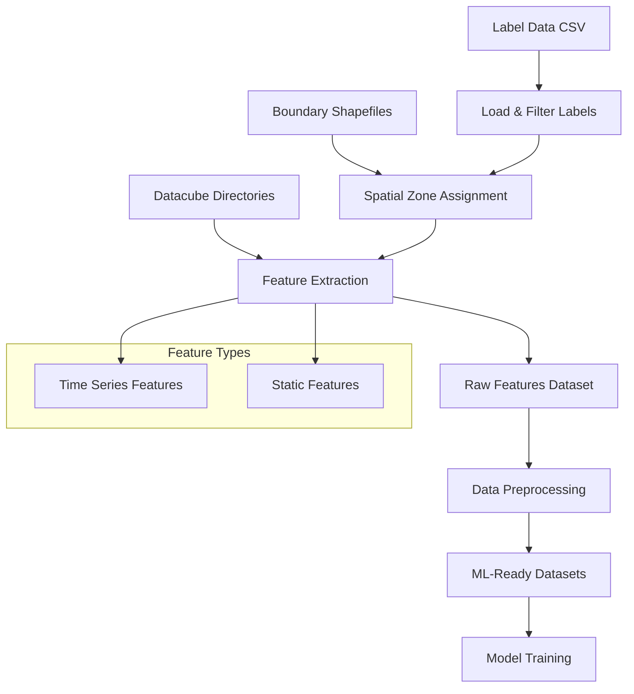

# Forest Type Classification Data Pipeline Overview

## Executive Summary

This document outlines the complete data pipeline for creating a machine learning dataset from spatially distributed forest type labels and multi-temporal satellite datacubes. The pipeline extracts time-series and static features at labeled point locations for training forest type classification models.

## Pipeline Architecture



## Data Sources

### 1. Label Data
- **Source**: `/fs1/tor_project/model_foresttype/data/2025_data_label_20250726/groud_label_data_ftype_for_model_20250826/ftype_total_2024_2025_train_model_20250826.csv`
- **Format**: CSV with UTM coordinates and forest type labels
- **Key Columns**:
  - `utm_x`, `utm_y`: Point coordinates (EPSG:32647)
  - `data`: Filter criterion (only 'ground' data used)
  - `ftype_mix`: Forest type labels for mixed classification
  - `ftype_nonmix`: Forest type labels for non-mixed classification
  - `year`: Year of data collection

### 2. Boundary Areas (AOI) - Selectable Zones
- **Purpose**: Define processing zones - **individual zones can be selected/excluded**
- **Available Zones** (8 total):
  - `mfl_cmf_2024`
  - `mfl_cmf_area_project_2025_chr_zone_1`
  - `mfl_cmf_area_project_2025_chr_zone_2`
  - `zone_1` through `zone_5`
- **Format**: Parquet files with polygon geometries
- **Selection Strategy**: Users can specify which zones to include in training

### 3. Datacube Features - Selectable by Year and Feature
- **Location**: `/fs2/ftype_mflf/shared_data/datacube/`
- **Structure**: Zone-based organization with feature subdirectories
- **Temporal Coverage**: 2019-2024 (individual years selectable)
- **Temporal Resolution**: 21 weekly timesteps per year (pre-interpolated)

#### Time-Series Features - Individual Selection (8 available):
1. **Biophysical Variables**:
   - `lai`: Leaf Area Index
   - `fapar`: Fraction of Absorbed Photosynthetically Active Radiation
   - `fcover`: Fractional Vegetation Cover

2. **Spectral Indices**:
   - `gvmi`: Global Vegetation Moisture Index
   - `ndvi`: Normalized Difference Vegetation Index
   - `slavi`: Specific Leaf Area Vegetation Index

3. **SAR Variables**:
   - `vh`: VH polarization backscatter
   - `vv`: VV polarization backscatter

#### Static Features - Individual Selection (2 available):
- `elevation`: Digital Elevation Model
- `slope`: Terrain slope

#### Selection Flexibility:
- **Year Selection**: Choose specific years (e.g., only 2020, 2022, 2024)
- **Zone Selection**: Choose specific processing zones
- **Feature Selection**: Choose specific indices/features to include
- **Data Quality**: All time-series data is pre-interpolated and ready to use

## Pipeline Stages

### Stage 1: Data Loading and Preparation
1. **Label Data Processing**:
   - Load CSV file into GeoDataFrame
   - Convert coordinates to numeric format
   - Create point geometries with EPSG:32647 CRS
   - Filter for ground truth data only

2. **Zone Assignment**:
   - Load all boundary polygon files
   - Perform spatial join to assign zones to points
   - Map zones to corresponding datacube directories
   - Remove points outside all zones

### Stage 2: Feature Extraction with Selection Control
1. **Configurable Selection**:
   - **Year Selection**: Choose specific years for each feature
   - **Zone Selection**: Include/exclude specific processing zones
   - **Feature Selection**: Choose which indices to extract
   - **Flexible Combinations**: Different features can use different year ranges

2. **Point-based Sampling**:
   - For each labeled point, extract values from selected raster datacubes
   - Use `rasterio.sample_gen()` for efficient point sampling
   - Extract only selected year-feature combinations

3. **Time-Series Feature Extraction**:
   - Extract 21-week time series for each selected feature-year combination
   - File naming patterns:
     - Biophysical: `cube_biophy_{feature}_{year}_W4before_to_W16after_21bands.tif`
     - Spectral: `cube_s2_{feature}_{year}_W4before_to_W16after_21bands.tif`
     - SAR: `cube_s1_{feature}_{year}_W4before_to_W16after_21bands.tif`
   - **Pre-interpolated data**: Time series are already interpolated and ready to use

4. **Static Feature Extraction**:
   - Extract single values from selected static rasters
   - File pattern: `{feature}_data.tif`
   - Only extract if feature is selected for inclusion

5. **Error Handling**:
   - Handle missing files gracefully
   - Skip unavailable year-feature combinations
   - Log warnings for problematic extractions

### Stage 3: Data Organization (No Scaling/Imputation)
1. **Raw Data Preservation**:
   - Keep original data values without scaling
   - No additional imputation (data is pre-interpolated)
   - Maintain data interpretability and physical meaning

2. **Feature Organization**:
   - **Year-Feature Structure**: Each feature-year combination as separate column
   - **Flexible Array Dimensions**: Adapt to selected features and years
   - **Missing Data Handling**: Use NaN for unavailable combinations only

3. **Target Preparation**:
   - Label encoding for categorical forest types
   - Support for both `ftype_mix` and `ftype_nonmix` targets
   - Maintain original target distributions

### Stage 4: Dataset Creation with Selection Metadata
1. **Data Splitting**:
   - Stratified train/test split based on target distribution
   - Configurable test size (default 20%)
   - Reproducible random state
   - Maintain spatial and temporal balance

2. **Selection Documentation**:
   - Record which years, zones, and features were selected
   - Store selection criteria in dataset metadata
   - Enable reproducible dataset creation

3. **Multiple Output Formats**:
   - **Raw Time-Series Format**: Full temporal resolution preserved
   - **Tabular Format**: Flattened features for traditional ML
   - **Both Targets**: Separate datasets for mix/nonmix classification
   - **Selection Metadata**: Complete record of data selection choices

## Quality Assurance

### Data Validation
- Coordinate validity checks
- CRS consistency verification
- Feature completeness assessment
- Target label distribution analysis

### Error Handling
- Graceful handling of missing files
- Data type validation
- Spatial intersection verification
- Memory management for large datasets

### Logging and Monitoring
- Comprehensive logging at all stages
- Progress tracking with progress bars
- Batch processing status updates
- Error reporting and statistics

## Performance Optimization

### Parallel Processing
- Multi-threaded feature extraction
- Configurable worker count
- Batch processing to manage memory

### Memory Management
- Batch processing of points
- Intermediate result caching
- Efficient data structures

### Storage Optimization
- Compressed pickle files for datasets
- CSV exports for human inspection
- Intermediate batch saves for recovery

## Output Structure

```
output_directory/
├── complete_features_dataset.pkl      # Raw extracted features (selected years/zones/features)
├── complete_features_dataset.csv      # Human-readable version
├── features_batch_*.pkl              # Intermediate batch results
├── ml_dataset_ftype_mix.pkl          # ML-ready dataset (mix target)
├── ml_dataset_ftype_nonmix.pkl       # ML-ready dataset (nonmix target)
├── selection_metadata.json           # Record of selected years/zones/features
├── feature_statistics.csv           # Feature quality statistics
├── dataset_summary_*.txt            # Human-readable summaries
└── pipeline_*.log                   # Execution logs
```

## Scalability Considerations

### Horizontal Scaling
- Zone-based processing enables distributed computation
- Batch processing supports large point datasets
- Modular design allows component parallelization

### Vertical Scaling
- Configurable memory usage through batch sizes
- Efficient raster sampling with rasterio
- Optimized data structures for large time series

### Storage Scaling
- Hierarchical storage with intermediate results
- Compression for large datasets
- Optional cleanup of intermediate files
